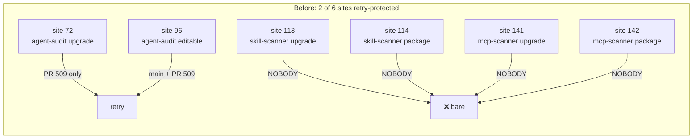
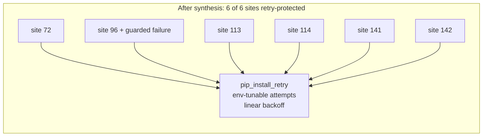
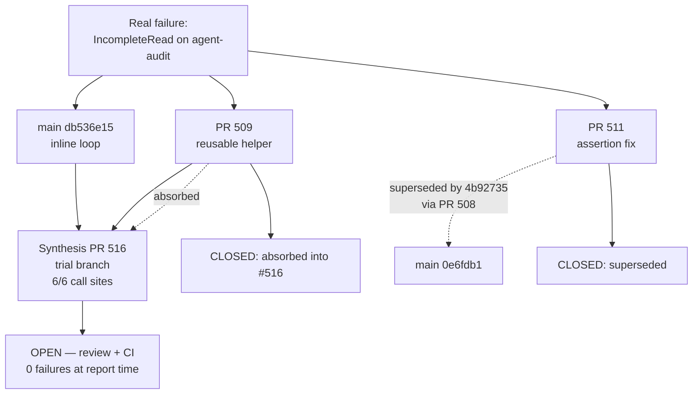

<!--
Memorialized to PT .agent/memory/semantic on branch fix/production-qualification-enforcement
(commit series ending 069e0df4). Cross-posted to orama-system PR 516.
Corrected 2026-11-16 (review 5915346045): the pip call-site census is 6 sites, 2 protected before
the synthesis, not 8 and 3; file references now use GitHub main links.
-->

# Synthesis Report — CI pip-install retry across the security-scan script

**Date:** 2026-11-15 · **Author/actor:** win-cline-20261115 (Windows Cline session; self-reported identity,
not independently verified) · **Method:** oramasys-method (AFRP Type C | Expert | Mode 2; 5-stage)
**Deliverable PR:** [orama-system #516](https://github.com/diazMelgarejo/orama-system/pull/516)
**Retired:** [PR #509](https://github.com/diazMelgarejo/orama-system/pull/509),
[PR #511](https://github.com/diazMelgarejo/orama-system/pull/511) · **Trial branch:**
`fix/ci-pip-install-retry-synthesis` (synthesis built on a trial branch per operator instruction;
main untouched)

---

## 0. Crosslinked references (everything this synthesis touches)

| Node | Link / path |
|---|---|
| **Synthesis PR (this work)** | [orama-system #516](https://github.com/diazMelgarejo/orama-system/pull/516) — head `8f8a0fb` |
| **Retired PR** (helper idea absorbed) | [orama-system #509](https://github.com/diazMelgarejo/orama-system/pull/509) — closed, superseded |
| **Retired PR** (assertion fix superseded) | [orama-system #511](https://github.com/diazMelgarejo/orama-system/pull/511) — closed, superseded |
| **Supersession source** | [orama-system #508](https://github.com/diazMelgarejo/orama-system/pull/508) — MERGED; main `0e6fdb18` (merge `0e6fdb1`) carries `4b92735` (assertions), `b8763ca`/`90108d9` (port fidelity), `2f490f0` (RECOVERY_SOURCE_TXT) |
| **Predecessor fix on main** | commit `db536e15` — inline retry loop (absorbed) |
| **PT enforcement PR (same-family)** | [Perpetua-Tools #514](https://github.com/diazMelgarejo/Perpetua-Tools/pull/514) — branch `fix/production-qualification-enforcement`: `360794b0` (gate enforcement), `a651890e` (isolation), `a6bf63d5` (fail-secure snapshot + probe skip), `65b9d55f` (round-2 regression), `069e0df4` (this memory commit) |
| **PT memory cards (this branch)** | `SAGA_JUNE_TO_RESUMPTION_AND_C6_WINDOWS_SYNTHESIS_2026-11-15.md` (not on PT main or on the merged #514 branch at the 2026-11-16 check), [FAIL_SECURE_QUALIFICATION_AND_WINDOWS_DACL_DOMAIN_KNOWLEDGE_2026-11-15.md](https://github.com/diazMelgarejo/Perpetua-Tools/blob/main/.agent/memory/semantic/FAIL_SECURE_QUALIFICATION_AND_WINDOWS_DACL_DOMAIN_KNOWLEDGE_2026-11-15.md), [2026-11-15-qualification-enforcement-c6-and-synthesis-session.md](https://github.com/diazMelgarejo/Perpetua-Tools/blob/main/.agent/memory/working/2026-11-15-qualification-enforcement-c6-and-synthesis-session.md), staged candidates `b553939e`/`e8fd0edf`/`1a9043c8`/`ebba3f7b`/`d29eae3b` |
| **C6 Windows evidence** | `tasks/c6_run/evidence-2026-11-15/` (local evidence on the Windows host, not in a repository) (runtime receipt, tier1 ×3, tier2 imports, ps51 verdicts, ntfs checks, WINDOWS-C6-QUALIFICATION-REPORT) |
| **Method skills applied** | oramasys-method (AFRP Type C / Mode 2, 5-stage), code-review (graph-first), orama-repo-rules (LESSONS-first), integrative-merge reference (classification before resolution) |
| **Canonical rule cards touched by the metabolization** | [docs/wiki/02-idempotent-installs.md](https://github.com/diazMelgarejo/orama-system/blob/main/docs/wiki/02-idempotent-installs.md) (retry census), [docs/wiki/09-policy-fail-closed-and-checklist.md](https://github.com/diazMelgarejo/orama-system/blob/main/docs/wiki/09-policy-fail-closed-and-checklist.md) (fail-secure snapshot), [docs/wiki/17-line-endings-and-encoding.md](https://github.com/diazMelgarejo/orama-system/blob/main/docs/wiki/17-line-endings-and-encoding.md) (PS 5.1 byte fidelity), [fragment-synthesis.md](https://github.com/diazMelgarejo/orama-system/blob/main/bin/orama-system/skills/oramasys-method/references/fragment-synthesis.md) (new) |
| **Board/LAN receipts** | GossipBus notes `de02e92c` (full report), `1e76d80b` (condensed), LAN drops `2026-11-15-win-cline-synthesis-report-ci-pip-retry.md`, `2026-11-15-win-cline-broadcast-all.md` |

## 0. Executive summary

One real CI failure — PyPI `IncompleteRead` while pip fetched build dependencies on the agent-audit
security-scan job — produced **three independent, fragmented fixes** on three different branches. The
operator halted a mechanical linear rebase (`main + 509`, then `+ 511`) and asked for the real
goals to be re-derived and the strengths of all sides amalgamated into the most elegant solution on
a trial branch. The synthesis:

- **One shared, env-tunable `pip_install_retry()` helper** (from #509) with the merged fix's linear
  per-attempt backoff folded in (`db536e15`).
- Applied to **every** `pip install` call site in the security-scan script — **6 of 6** — including the
  four sites *neither* side covered (skill-scanner and mcp-scanner upgrade + package installs).
- The merged fix's **explicit guarded failure** (clear message + `return 1`) preserved at the critical
  agent-audit editable-install site.
- **PR #511 retired** (its assertion fix landed in main via #508, commit `4b92735`); **PR #509 retired**
  (its helper idea absorbed and generalized by #516).
- Verification: `bash -n` clean; behavioral smoke test (recovery on the third attempt, env-tunable
  attempts, linear backoff logging); workflow-structure suite **12 passed / 1 skipped**; CI on #516 at
  time of writing: **27 SUCCESS / 1 skipped / 1 neutral / 2 in-progress / 0 failures**.

---

## 1. Stage 1 — Context Immersion: the goals are now clear

### 1.1 The real failure (the motivation behind every change)

The `agent-audit` security-scan job died mid-install:

```text
IncompleteRead while fetching hatchling (PyPI truncated wheel) → pip left with nothing to install
```

This is a **runner network blip**, not a code defect: the same script had passed many runs before. The
correct response class is *transient infrastructure retry*, not a code or pin change — a conclusion
both fix authors independently reached.

### 1.2 The three fragments

| # | Change | Where it lives | What it does | Motivation (re-derived) | Strengths | Weaknesses |
|---|--------|----------------|--------------|--------------------------|-----------|------------|
| 1 | `db536e15` *fix(ci): retry the agent-audit install after a broken download* | **merged to main** (via #508) | Inline 3-attempt loop around the agent-audit **editable install** only; linear backoff `attempt * 2`; explicit `return 1` + stderr message after exhaustion | Fix the exact observed failure, minimal blast radius | Explicit failure accounting consistent with the function's own contract; message names the site | One-off inline loop — not reusable; covers 1 of 6 call sites; fixed attempt count |
| 2 | `18f10d9` *fix(ci): retry pip install for agent-audit job* (PR #509, open) | branch `cursor/ci-autofix-agent-audit-pip-retry` | Reusable `pip_install_retry()` — env-tunable `PIP_INSTALL_ATTEMPTS` / `PIP_INSTALL_RETRY_DELAY_SEC`; applied to the pip **upgrade** and the editable install | Same failure, DRY instinct: one helper, tunable without editing the script | Reusable + configurable; correct instinct to cover the upgrade call too | Still only 2 of 6 call sites; fixed delay (no backoff); bare call semantics under `set -e` unexamined |
| 3 | `38ec8b6` *test(discover): expect mac port in explicit MAC_IP assertions* (PR #511, open) | branch `cursor/ci-fix-discover-mac-port-assertions` | Adds `"port": 1234` to two `test_explicit_mac_ip_accepted_without_evidence` assertions | Fix the same failing test jobs #508's CI exposed | Correct assertion shape | **Fully superseded** — the identical fix merged via #508 (`4b92735`) before this branch's CI ran |

### 1.3 Why the fragments diverged (root cause of the fragmentation)

Two agents saw the same red CI and each shipped a partial fix on a separate branch, while a third fix
for the *other* half of the failure (the test assertions) had already merged. No single place held the
whole picture: the failure was one event with **two** symptom surfaces (a pip blip *and* stale test
expectations) and **three** response fragments. The operator's halt of the linear rebase was the
moment the fragments could be re-derived from the goal instead of stacked.

---

## 2. Stage 2 — Visionary Architecture: the 3-way classification and the synergy

### 2.1 Integrative-merge classification of every changed hunk

| Hunk (common file `scripts/ci/run_agent_security_scans.sh`) | main `db536e15` | PR #509 `18f10d9` | Classification | Synthesis disposition |
|---|---|---|---|---|
| New reusable retry helper | — (inline instead) | ✅ `pip_install_retry()` | **Complementary capability** | **Keep (from #509)**, add backoff |
| Backoff strategy | ✅ linear `attempt * 2` | fixed `delay` | **Complementary idea** | **Merge both**: `delay * attempt` with env base |
| Failure accounting at the editable install | ✅ explicit message + `return 1` | bare call (aborts via `set -e`) | **main is stronger** | **Keep (from main)**, calling the shared helper |
| agent-audit pip **upgrade** retry | ✗ | ✅ | **#509-only coverage** | **Keep (from #509)** |
| skill-scanner upgrade + package installs | ✗ | ✗ | **Neither side — coverage gap** | **New in synthesis** |
| mcp-scanner upgrade + package installs | ✗ | ✗ | **Neither side — coverage gap** | **New in synthesis** |

### 2.2 The coverage gap — the synergy beyond the 3-way diff

The script
([run_agent_security_scans.sh](https://github.com/diazMelgarejo/orama-system/blob/main/scripts/ci/run_agent_security_scans.sh))
has **6** `pip install` call sites (lines 72, 96, 113, 114, 141 and 142 at `db536e15`). The two agent
fixes covered **2** between them: line 96 (both main and #509) and line 72 (#509 only). The
remaining **4** carry identical IncompleteRead exposure on every run — they were simply not the site
that happened to fail that day. aguara (`go install`) and ramparts (`cargo install`) are not pip
sites and are excluded from the count.





### 2.3 The synthesized helper

```bash
# PyPI occasionally returns truncated wheels on CI runners (IncompleteRead
# while fetching build dependencies). Retry installs before failing the job.
# Attempts and delay are env-tunable so a flaky runner day can be tuned
# without editing this script; the delay grows linearly per attempt.
pip_install_retry() {
  local attempts="${PIP_INSTALL_ATTEMPTS:-3}"
  local delay="${PIP_INSTALL_RETRY_DELAY_SEC:-5}"
  local n
  for ((n = 1; n <= attempts; n++)); do
    if python3 -m pip install "$@"; then
      return 0
    fi
    if (( n < attempts )); then
      log "WARN pip install failed (attempt ${n}/${attempts}); retrying in $((delay * n))s"
      sleep "$((delay * n))"
    fi
  done
  return 1
}
```

### 2.4 Call-site disposition (6 of 6)

| Line (main) | Site | Before | After |
|---|---|---|---|
| 72 | agent-audit `pip --upgrade` | bare (abort on blip) | `pip_install_retry -q --upgrade pip` |
| ~96 | agent-audit editable install | inline 3-attempt loop | `if ! pip_install_retry -q -e ...; then echo ...; return 1; fi` (guarded failure + message preserved) |
| 113 | skill-scanner `pip --upgrade` | bare | `pip_install_retry -q --upgrade pip` |
| 114 | skill-scanner package | bare | `pip_install_retry -q cisco-ai-skill-scanner` |
| 141 | mcp-scanner `pip --upgrade` | bare | `pip_install_retry -q --upgrade pip` |
| 142 | mcp-scanner package | bare | `pip_install_retry -q cisco-ai-mcp-scanner` |
| — | `aguara`, `ramparts` | non-pip installs (`go install` / `cargo install`) | out of scope — different failure class, untouched |

### 2.5 PR #511 disposition (decided before any rebase)

`38ec8b6` fixes the exact two assertions that `4b92735` (merged via #508) already fixed. A rebase onto
any current line yields an empty or conflicting diff. **Verdict: retire as superseded** — no rebase can
add value. (This is why the operator's instinct — "it is possible that both PR should be closed and
retired" — was correct for #511, and half-correct for #509: #509's *idea* survives inside the synthesis.)

---

## 3. Stage 3/4 — Masterful Execution and verification

### 3.1 Trial branch (never touching main)

```text
branch: fix/ci-pip-install-retry-synthesis  (from origin/main 0e6fdb18, in a dedicated worktree)
commit: 8f8a0fb  — 1 file changed, 29 insertions(+), 17 deletions(-)
```

### 3.2 Verification matrix

| Check | Method | Result |
|---|---|---|
| Syntax | `bash -n scripts/ci/run_agent_security_scans.sh` | ✅ rc 0 |
| Lint | shellcheck | ⚪ not installed on this host — skipped (CI may run it) |
| Retry recovers | smoke test: stubbed `python3` fails twice then succeeds | ✅ rc 0 **after exactly 3 calls** |
| Exhaustion fails | stubbed `python3` always fails, `PIP_INSTALL_ATTEMPTS=2` | ✅ rc 1 **after exactly 2 calls** (env honored) |
| Backoff logging | observed `WARN pip install failed (attempt n/N); retrying in Xs` per attempt | ✅ linear delay honored |
| No bare call sites left | grep for `pip install` outside the helper | ✅ only the helper's own internal call remains |
| Workflow pins/caches/triggers | `tests/test_agent_security_workflow.py` + `test_pr483_security_regressions.py` | ✅ **12 passed, 1 skipped** |
| CI (PR #516) | GitHub Actions on head `8f8a0fb` | ✅ at report time: **27 SUCCESS / 1 skipped / 1 neutral / 2 in-progress / 0 failures** (`test (3.12)` matrix + `skill-scanner` still running) |

### 3.3 Smoke-test transcript (excerpt)

```text
LOG: WARN pip install failed (attempt 1/3); retrying in 0s
LOG: WARN pip install failed (attempt 2/3); retrying in 0s
SMOKE1: rc=0 after 3 calls (expected 3)
LOG: WARN pip install failed (attempt 1/2); retrying in 0s
SMOKE2: rc=1 after 2 calls (expected 2, env-tunable)
```

---

## 4. Shipment and retirement



| PR | Disposition | Reason recorded on the PR |
|---|---|---|
| [#516](https://github.com/diazMelgarejo/orama-system/pull/516) | **OPEN** — the synthesis | Carries both sides' strengths plus the coverage extension |
| [#509](https://github.com/diazMelgarejo/orama-system/pull/509) | **CLOSED** (superseded) | Helper idea absorbed into #516 and extended to all call sites |
| [#511](https://github.com/diazMelgarejo/orama-system/pull/511) | **CLOSED** (superseded) | Identical fix merged via #508 (`4b92735`); rebase yields an empty diff |

---

## 5. Crystallize — durable lessons

1. **One failure can legitimately produce several partial fixes.** When a second red run appears on a
   different branch, ask *what class of failure is this* before writing a third patch — here the answer
   (transient runner network) would have immediately suggested a shared helper covering all sites.
2. **Coverage completeness beats point fixes.** The 3-way diff was the beginning; the call-site census
   (6 sites, 2 protected) was the actual opportunity. Audit the *failure class* across all its exposure
   points, not only the site that happened to fail.
3. **Reusable + configurable beats inline**, but only alongside the original's *failure-accounting*
   strengths — synthesis means amalgamating strengths, not picking a winner (exactly the operator's
   "strengths of all sides amalgamated and harmonized").
4. **Classification before rebase.** The linear rebase would have produced a conflict-resolution that
   kept one side's shape; the classification table showed #511 was already empty and #509's helper was
   the keeper, changing the plan to *retire-and-synthesize*.
5. **Trial branch + smoke test before any push.** The retry helper was behaviorally verified with
   stubbed pip before it ever reached a PR, per the repo's verify-before-done gate.

---

## 6. Appendix — artifacts and provenance

| Artifact | Path / ref |
|---|---|
| Synthesis PR | [orama-system #516](https://github.com/diazMelgarejo/orama-system/pull/516) (head `8f8a0fb`) |
| Trial branch | `fix/ci-pip-install-retry-synthesis` (worktree `ultrathink/wt-509`) |
| Retired PRs | #509 (closed, superseded-by comment), #511 (closed, superseded-by comment) |
| Merged predecessor | `db536e15` on main `0e6fdb18` (via PR #508 merge `0e6fdb1`) |
| Supersession source | `4b92735` (test assertions), merged via #508 |
| Evidence logs | `ultrathink/test-tmp/` (local Windows workspace, not in a repository) — `smoke.sh`, `syn_wf_tests.txt`, `observe516_final.txt`, `rebase509.txt`, `synthesis_apply2.py` |
| Method refs | oramasys-method SKILL.md (5-stage), code-review SKILL.md (graph-first), orama-repo-rules (LESSONS-first) |

*This report is evidence and analysis, not an approval to merge; review and merge authority stays with
the operator and the assigned reviewer.*
